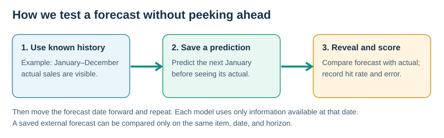
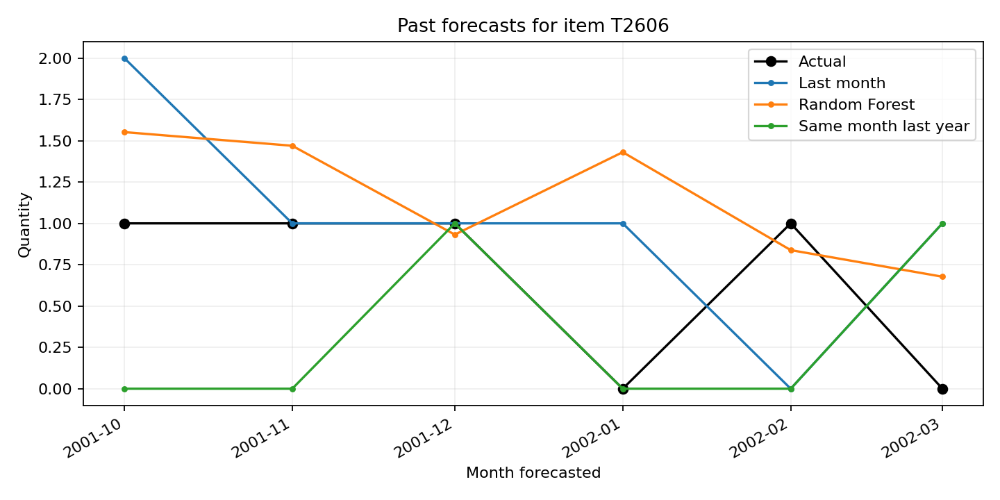

# Practical Manufacturing Demand Forecasting

[](https://github.com/Yu-ChangCheng/manufacturing-forecasting-framework/actions/workflows/ci.yml)


A small, reproducible framework for monthly item-level demand forecasting. It helps a practitioner answer a basic question: **does a proposed model perform better than a simple forecast when tested on months it could not yet see?**


The repository includes a [reproducible fictional seasonal-demand demo](docs/random-forest-demo.md) and a small, attributed sample of public Monash car-parts sales data hosted on Hugging Face. It has no employer database connector, private sales records, credentials, or proprietary code. It is an educational starting point, not a claim that machine learning always improves forecasts.

## Start here: guided local app

This is the easiest path if you do not use Python regularly. The app lets you upload a CSV or Excel `.xlsx` file, choose which columns contain dates, item IDs, and quantities, check missing months, run a backtest, see a chart, and download a forecast and plain-language report. It processes your file on your own computer; the app does not send it to Hugging Face. For Excel, it reads the first sheet.

On Windows, after installing Python 3.11 or newer, you can double-click [`START_APP.bat`](START_APP.bat). It creates a local `.venv`, installs the app's Python packages, and launches the browser. The first run needs an internet connection to install packages. The file contains no credentials or external data upload commands; you can read it before running it.

On Windows PowerShell, from this repository folder:

```powershell
python -m venv .venv
.\.venv\Scripts\python.exe -m pip install -e ".[app]"
.\.venv\Scripts\python.exe -m streamlit run streamlit_app.py
```

Your browser should open the local app. Keep the default **Random Forest teaching example**, then click **Run the backtest and make a future forecast**. Move the backtest slider to 12 origins to reproduce the [demo results](docs/random-forest-demo.md). You can also select **Explore public car-parts example** or **Use my own file**. Press `Ctrl+C` in PowerShell to stop the app. See the [illustrated step-by-step guide](docs/getting-started.md) for sample files, metric explanations, and troubleshooting. If you prefer the command line, use the steps below.



The fictional demo deliberately has recurring seasonality that Random Forest can learn. Its included 12-origin, one-month-ahead backtest gives:

| Method | ±25% hits | WAPE |
| --- | ---: | ---: |
| Random Forest | 66/72 (91.7%) | 10.8% |
| Same month last year | 62/72 (86.1%) | 12.9% |

These are **synthetic results**, not evidence about an employer or a guarantee on other data. The public car-parts sample has 51 months for five items; its source replaced originally missing values with zeros. It is useful for seeing a harder case where Random Forest does not lead on hit rate. [Data source and attribution](docs/public-data.md).

## Technical notebook and configurable model

The [editable workbench notebook](notebooks/monthly_demand_workbench.ipynb) walks through importing your CSV or Excel file, cleaning and inspecting it, selecting lag/rolling/calendar features, reserving later months as a test, configuring or automatically tuning a Random Forest, comparing baselines, visualizing results, and saving a final local model. The reusable implementation is [`mfg_forecast.workbench`](src/mfg_forecast/workbench.py).

To use the notebook, install the `[notebook]` extra in a virtual environment and run `python -m jupyter lab` from this folder. Open `notebooks/monthly_demand_workbench.ipynb` and choose **Run All** with the included fictional sample first. Then edit the clearly marked input cell for your own data. See the [technical guide](docs/technical-workbench.md) for exact commands, data rules, tuning settings, and limits. All notebook outputs and model files are saved only under Git-ignored `outputs/`.

## What you get

- Strict checks for monthly CSV format, duplicate item-month pairs, negative quantities, and missing months.
- Two easy-to-understand baselines: last observed month and the corresponding month of the previous year.
- A Random Forest that uses only information available at each forecast origin.
- An optional LSTM example for comparing a sequence model with simpler approaches.
- Rolling-origin backtests, a **within ±25% hit rate**, WAPE, bias, matched external-forecast comparison, and an optional chart.
- A configurable Random Forest experiment with a chronological holdout, earlier rolling tuning folds, feature inspection, and a locally saved model.

The training and forecast process is intentionally transparent. The code is small enough to read and adapt, while the [methodology guide](docs/methodology.md) describes important limitations.

### Model and evaluation in one minute

At forecast origin $o$, the model uses only quantities observed through that month. For item $i$, a lag such as $\operatorname{lag}_{12}=y_{i,o-11}$ represents the quantity from the same month a year before a one-month-ahead target. The forest averages $B$ regression trees and clips negative predictions to zero:

$$
\hat y_{i,o+h}=\max\!\left(0,\frac{1}{B}\sum_{b=1}^{B}T_b(x_{i,o,h})\right).
$$

Here $h$ is the forecast horizon and $x_{i,o,h}$ contains only known lag, rolling-mean, item, and calendar features. The Random Forest method follows [Breiman (2001)](https://doi.org/10.1023/A:1010933404324); repeated historical forecast origins follow the evaluation approach discussed by [Tashman (2000)](https://doi.org/10.1016/S0169-2070(00)00065-0). On matched item-month forecasts, the project's **±25% hit rate** is the fraction satisfying $|\hat y-y|\leq0.25|y|$. The rule is a project-specific evaluation threshold, not a result from a cited paper. Report it with WAPE, sample size, horizon, and the same-row baselines. See the [full formulas and validation protocol](docs/methodology.md) and [annotated research references](docs/references.md).

## 1. Install

Use Python 3.11 or 3.12 for the broadest package compatibility. In PowerShell:

```powershell
cd manufacturing-forecasting-framework
py -3.12 -m venv .venv
.\.venv\Scripts\Activate.ps1
python -m pip install --upgrade pip
python -m pip install -e .
```

The `cd` command assumes you are in this project's parent folder. After the repository is published, other users can first run `git clone https://github.com/Yu-ChangCheng/manufacturing-forecasting-framework.git`. See [PUBLISHING.md](PUBLISHING.md) for a privacy review and publication steps.

If `py -3.12` is unavailable, use an installed Python 3.11+ executable to create the virtual environment. On macOS or Linux, replace the `py` line with `python3 -m venv .venv` and activate with `source .venv/bin/activate`.

To include the optional neural-network example, run `python -m pip install -e ".[lstm]"`. TensorFlow takes longer to install and train; begin with the baselines and Random Forest.

### Run the automated tests

Install the test extra in the same environment, then check data preparation, leakage, benchmark matching, and metrics:

```powershell
python -m pip install -e ".[test]"
python -m pytest -q tests
```

All tests should pass. The sample backtest below checks the complete command-line workflow as well. Its data and scores are fictional and must not be presented as results from a real manufacturer.

## 2. Try the Random Forest teaching sample

The new teaching sample is `examples/synthetic_rf_demo.csv`. It was generated with a fixed seed, six items, a repeated yearly demand pattern, and noise. Run the full 2025 backtest:

```powershell
python scripts/generate_rf_demo.py
mfg-forecast backtest --data examples/synthetic_rf_demo.csv --horizon 1 --origins 12
mfg-forecast plot --predictions outputs/backtest_predictions.csv --item DEMO-04
```

Read the [explanation, diagram, score table, and chart](docs/random-forest-demo.md). The command creates `outputs/backtest_predictions.csv`, `outputs/backtest_metrics.csv`, and `outputs/backtest_chart.png`. These output files are ignored by Git.

You can also test the public Hugging Face example from the command line:

```powershell
mfg-forecast backtest --data examples/hf_car_parts_sample.csv --horizon 1 --origins 6
```

For this selected five-item, six-origin sample, the last-month baseline has a higher ±25% hit rate while Random Forest has lower WAPE. The measures answer different questions; inspect the underlying item-month rows before choosing a method. 

## 3. Use your own monthly CSV locally

Prepare a CSV with these exact columns:

```csv
month,item_id,quantity
2022-01-01,ITEM-A,105
2022-02-01,ITEM-A,98
2022-03-01,ITEM-A,113
```

`month` must be the **first day** of the month. `item_id` is any stable, nonempty identifier. `quantity` is the nonnegative **actual demand or sales quantity**, not a forecast. Include exactly one row per item and month, and at least 24 consecutive months for each item you want forecasted. More history is needed to train and evaluate multi-month horizons; 48–72 months is a better starting point.

**Decide what a missing month means before preparing the CSV.** If the item was active with zero demand, include an explicit `0` row. If the observation is unknown, correct the source rather than silently inventing a zero. Do not upload private business data to this public repository.

Then run:

```powershell
mfg-forecast backtest --data path/to/your_monthly_history.csv --horizon 1 --origins 6
mfg-forecast forecast --data path/to/your_monthly_history.csv --horizon 1
```

The second command predicts the month after the last observed month and writes `outputs/future_forecast.csv`. Try `--horizon 3` for a three-month-ahead target, then backtest that same horizon before using its forecasts.

To run only simple baselines, add `--models naive,seasonal_naive`. To include the optional LSTM, install the extra dependency and use `--models naive,seasonal_naive,random_forest,lstm --lstm-epochs 15`.

## 4. Compare an existing forecast fairly

If your sales team or another system saved its forecasts **before actuals were known**, make a separate CSV like this:

```csv
origin_month,target_month,item_id,forecast_qty
2025-01-01,2025-02-01,ITEM-A,112
2025-02-01,2025-03-01,ITEM-A,108
```

Then add it to a rolling backtest:

```powershell
mfg-forecast backtest --data path/to/your_monthly_history.csv --benchmark path/to/saved_forecasts.csv --horizon 1 --origins 6
```

The program restricts **all** models to the same matched origin, target month, and item rows. This matters: comparing two percentages from different items, months, or forecast horizons can give a misleading answer. The benchmark file should be an independently preserved historical forecast, not a number reconstructed after actual sales were known.

## 5. Read the metrics correctly

| Metric | Meaning |
| --- | --- |
| `n` | Number of matched item-month forecasts. |
| `hit_rate_25` | Share with `abs(forecast - actual) <= 0.25 * abs(actual)`. A value of `0.80` means 80% hit rate. |
| `wape` | Sum of absolute errors divided by sum of absolute actual quantities. Lower is better. |
| `bias_ratio` | Sum of signed errors divided by sum of absolute actual quantities. Positive means overforecasting. |

For a zero-actual row, the ±25% hit rule counts **only a zero forecast** as a hit. WAPE is undefined if the total actual quantity is zero; the output leaves it blank. The hit rate and WAPE are distinct metrics and must not be interchanged.

The tool reports model scores; **you** must decide whether a difference is meaningful for planning. Check the number and mix of items, volume, intermittent demand, forecast horizon, business rules, and stability across different time periods. A model that wins on a six-month sample may lose later.

## Folder guide

```text
examples/synthetic_rf_demo.csv        Fictional seasonal-demand data
examples/hf_car_parts_sample.csv      Attributed public teaching sample
notebooks/monthly_demand_workbench.ipynb  Editable technical experiment
src/mfg_forecast/workbench.py         Feature selection, time split, tuning, plots
src/mfg_forecast/prepare.py           Column mapping and gap handling
src/mfg_forecast/core.py              Baselines, backtesting, metrics
streamlit_app.py                      Guided beginner app
START_APP.bat                         Windows app launcher
docs/technical-workbench.md          Notebook and API guide
docs/random-forest-demo.md           Fictional data recipe and results
docs/getting-started.md              Beginner walkthrough
docs/public-data.md                  Hugging Face source and license
docs/methodology.md                  Equations, validation, and limits
docs/references.md                   Research papers and their role here
tests/                               Leakage, preparation, and demo checks
```

## Data and confidentiality

This project deliberately has no company connection strings or database-writing functions. Keep employer data, customer information, internal schemas, source code, and credentials in approved private systems. If you use a real dataset locally, obtain the necessary authorization and review any generated chart or output before sharing it. The `data/private/` and `outputs/` folders are excluded from Git, but a filename exclusion is not a substitute for checking what you commit. The guided app is intended to run locally; hosting it on a public server changes who can access uploaded files.

## License and feedback

The original code in this repository is [MIT licensed](LICENSE). Use [CITATION.cff](CITATION.cff) or GitHub's **Cite this repository** link to cite the software; cite the underlying papers separately when discussing their methods or dataset. Issues and reproducible synthetic examples are welcome. Describe the data shape, horizon, and validation approach when reporting a model result; do not post private records.
