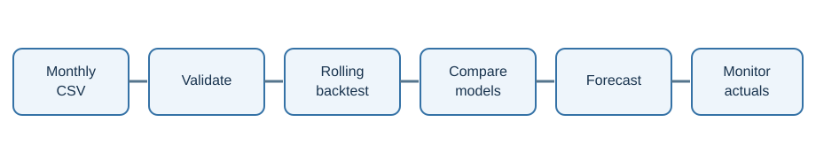

# Practical Manufacturing Demand Forecasting

A small, reproducible framework for monthly item-level demand forecasting. It helps a practitioner answer a basic question: **does a proposed model perform better than a simple forecast when tested on months it could not yet see?**



The public example uses **fictional, computer-generated data**. It has no employer database connector, private sales records, credentials, or proprietary code. It is an educational starting point, not a ready-made planning system or a claim that machine learning always improves forecasts.

## What you get

- Strict checks for monthly CSV format, duplicate item-month pairs, negative quantities, and missing months.
- Two easy-to-understand baselines: last observed month and the corresponding month of the previous year.
- A Random Forest that uses only information available at each forecast origin.
- An optional LSTM example for comparing a sequence model with simpler approaches.
- Rolling-origin backtests, a **within ±25% hit rate**, WAPE, bias, matched external-forecast comparison, and an optional chart.

The training and forecast process is intentionally transparent. The code is small enough to read and adapt, while the [methodology guide](docs/methodology.md) describes important limitations.

## 1. Install

Use Python 3.11 or 3.12 for the broadest package compatibility. In PowerShell:

```powershell
cd manufacturing-forecasting-framework
py -3.12 -m venv .venv
.\.venv\Scripts\Activate.ps1
python -m pip install --upgrade pip
python -m pip install -e .
```

The `cd` command assumes you are in this project's parent folder. After the repository is published, other users can first run `git clone https://github.com/Yu-ChangCheng/manufacturing-forecasting-framework.git`. See [PUBLISHING.md](PUBLISHING.md) for a privacy review and publication steps.

If `py -3.12` is unavailable, use an installed Python 3.11+ executable to create the virtual environment. On macOS or Linux, replace the `py` line with `python3 -m venv .venv` and activate with `source .venv/bin/activate`.

To include the optional neural-network example, run `python -m pip install -e ".[lstm]"`. TensorFlow takes longer to install and train; begin with the baselines and Random Forest.

### Run the automated tests

Install the test extra in the same environment, then run the five checks for data validation, leakage, benchmark matching, and metrics:

```powershell
python -m pip install -e ".[test]"
python -m pytest -q tests/test_core.py
```

All five tests should pass. The sample backtest below checks the complete command-line workflow as well. Its data and scores are fictional and must not be presented as results from a real manufacturer.

## 2. Try the fictional sample

The repository includes `examples/synthetic_demand.csv`. You can regenerate it with:

```powershell
mfg-forecast sample-data --output examples/synthetic_demand.csv
```

Run a one-month-ahead backtest at the last six eligible forecast origins:

```powershell
mfg-forecast backtest --data examples/synthetic_demand.csv --horizon 1 --origins 6
```

The command creates `outputs/backtest_predictions.csv` and `outputs/backtest_metrics.csv` and prints a small metric table. It trains separately at each origin using only demand known by that month, then compares the prediction with the later actual quantity. These output files are ignored by Git.

Plot one fictional item:

```powershell
mfg-forecast plot --predictions outputs/backtest_predictions.csv --item SYNTH-001
```

Open `outputs/backtest_chart.png`. It shows actual demand and each model's forecasts across the backtest months.

## 3. Use your own monthly CSV locally

Prepare a CSV with these exact columns:

```csv
month,item_id,quantity
2022-01-01,ITEM-A,105
2022-02-01,ITEM-A,98
2022-03-01,ITEM-A,113
```

`month` must be the **first day** of the month. `item_id` is any stable, nonempty identifier. `quantity` is the nonnegative **actual demand or sales quantity**, not a forecast. Include exactly one row per item and month, and at least 24 consecutive months for each item you want forecasted. More history is needed to train and evaluate multi-month horizons; 48–72 months is a better starting point.

**Decide what a missing month means before preparing the CSV.** If the item was active with zero demand, include an explicit `0` row. If the observation is unknown, correct the source rather than silently inventing a zero. Do not upload private business data to this public repository.

Then run:

```powershell
mfg-forecast backtest --data path/to/your_monthly_history.csv --horizon 1 --origins 6
mfg-forecast forecast --data path/to/your_monthly_history.csv --horizon 1
```

The second command predicts the month after the last observed month and writes `outputs/future_forecast.csv`. Try `--horizon 3` for a three-month-ahead target, then backtest that same horizon before using its forecasts.

To run only simple baselines, add `--models naive,seasonal_naive`. To include the optional LSTM, install the extra dependency and use `--models naive,seasonal_naive,random_forest,lstm --lstm-epochs 15`.

## 4. Compare an existing forecast fairly

If your sales team or another system saved its forecasts **before actuals were known**, make a separate CSV like this:

```csv
origin_month,target_month,item_id,forecast_qty
2025-01-01,2025-02-01,ITEM-A,112
2025-02-01,2025-03-01,ITEM-A,108
```

Then add it to a rolling backtest:

```powershell
mfg-forecast backtest --data path/to/your_monthly_history.csv --benchmark path/to/saved_forecasts.csv --horizon 1 --origins 6
```

The program restricts **all** models to the same matched origin, target month, and item rows. This matters: comparing two percentages from different items, months, or forecast horizons can give a misleading answer. The benchmark file should be an independently preserved historical forecast, not a number reconstructed after actual sales were known.

## 5. Read the metrics correctly

| Metric | Meaning |
| --- | --- |
| `n` | Number of matched item-month forecasts. |
| `hit_rate_25` | Share with `abs(forecast - actual) <= 0.25 * abs(actual)`. A value of `0.80` means 80% hit rate. |
| `wape` | Sum of absolute errors divided by sum of absolute actual quantities. Lower is better. |
| `bias_ratio` | Sum of signed errors divided by sum of absolute actual quantities. Positive means overforecasting. |

For a zero-actual row, the ±25% hit rule counts **only a zero forecast** as a hit. WAPE is undefined if the total actual quantity is zero; the output leaves it blank. The hit rate and WAPE are distinct metrics and must not be interchanged.

The tool reports model scores; **you** must decide whether a difference is meaningful for planning. Check the number and mix of items, volume, intermittent demand, forecast horizon, business rules, and stability across different time periods. A model that wins on a six-month sample may lose later.

## Folder guide

```text
examples/synthetic_demand.csv   Fictional sample only
src/mfg_forecast/core.py         Validation, models, backtesting, metrics
src/mfg_forecast/cli.py          Commands and chart
docs/methodology.md              Evaluation rules and limitations
docs/workflow.svg                Overview diagram
tests/test_core.py               Leakage and metric checks
```

## Data and confidentiality

This project deliberately has no company connection strings or database-writing functions. Keep employer data, customer information, internal schemas, source code, and credentials in approved private systems. If you use a real dataset locally, obtain the necessary authorization and review any generated chart or output before sharing it. The `data/private/` and `outputs/` folders are excluded from Git, but a filename exclusion is not a substitute for checking what you commit.

## License and feedback

The original code in this repository is MIT licensed. Issues and reproducible synthetic examples are welcome. Describe the data shape, horizon, and validation approach when reporting a model result; do not post private records.
