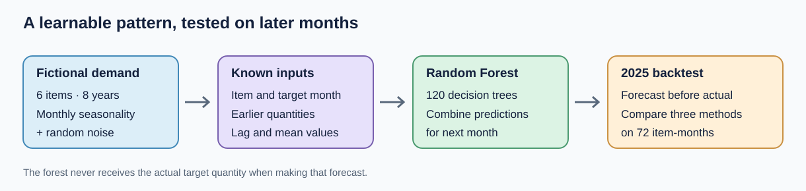
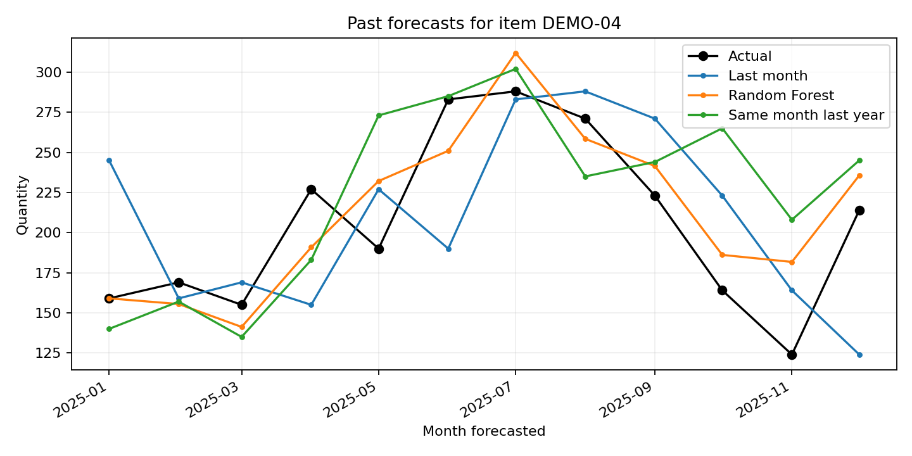

# A Random Forest example you can explain

**Question:** Can previous monthly quantities and the calendar month help predict next month's demand? This fictional example has a stable yearly pattern, so it is a good first demonstration of a machine-learning forecast. It is intentionally easier than irregular real sales data.



## The data recipe

[`scripts/generate_rf_demo.py`](../scripts/generate_rf_demo.py) creates [`examples/synthetic_rf_demo.csv`](../examples/synthetic_rf_demo.csv) using a fixed random seed. It contains six fictional items and 96 consecutive months, January 2018 through December 2025. Every item uses the same recurring 12-month shape, scaled by its own base quantity:

```text
expected monthly quantity = item base quantity × month-of-year factor
observed quantity = round(expected quantity + random noise)
random noise has standard deviation = 12% of that item's base quantity
```

For example, the January factor is **0.72** and the July factor is **1.47**. The other factors and the exact seed are in the generator. The resulting quantities are invented; they are not drawn from a manufacturer or Hugging Face. Because the seasonal shape repeats, the model has a real signal to learn, yet the noise means that no method knows an exact future quantity.

## What each method sees

- **Last month:** repeat the latest observed quantity.
- **Same month last year:** repeat the observed quantity for the corresponding month one year ago.
- **Random Forest:** use item ID, the month being forecast, forecast horizon, six historical lag values, and three averages of recent quantities. It fits 120 regression trees and averages their predictions. All lag and average values end at the forecast origin. The implementation is in [`core.py`](../src/mfg_forecast/core.py).

The calendar month is useful because July tends to be higher than January. A forest can also average across multiple noisy examples instead of relying on just one past month. The same-month-last-year baseline is deliberately strong here; a model should be compared with it, not only with last month.

## Time-based result

We ran one-month-ahead forecasts at **12 rolling origins**. Those forecasts target January through December 2025, six items each month. At each origin, the forest was fitted again using only quantities observed through that origin. All methods were scored on the same **72 item-month outcomes**.

| Method | Within ±25% of actual | Hit rate | WAPE |
| --- | ---: | ---: | ---: |
| Last month | 50 / 72 | 69.4% | 18.3% |
| Same month last year | 62 / 72 | 86.1% | 12.9% |
| Random Forest | 66 / 72 | 91.7% | 10.8% |

WAPE is total absolute error divided by total actual quantity, so lower is better. The ±25% hit rule is described in the [methodology](methodology.md). These values are from this fixed fictional sample with the included model settings; they are not a promise of similar performance on other data.



You can reproduce the data and numbers from the repository root after [installing the package](../README.md#1-install):

```powershell
python scripts/generate_rf_demo.py
mfg-forecast backtest --data examples/synthetic_rf_demo.csv --horizon 1 --origins 12
mfg-forecast plot --predictions outputs/backtest_predictions.csv --item DEMO-04
```

The local app opens this teaching example by default. Click **Run the backtest and make a future forecast**, then compare the methods and click individual items in the chart. The app starts with six origins for speed; move the slider to **12** to reproduce the full table above. The future forecast is for January 2026 and cannot yet be scored by this data file.

## Learn from existing tutorials

The [scikit-learn lagged-features forecasting tutorial](https://scikit-learn.org/stable/auto_examples/applications/plot_time_series_lagged_features.html) shows how to turn earlier observations into model inputs and why time-respecting evaluation matters. Its example uses a **gradient boosting regressor**, so this repository applies that approach with a [RandomForestRegressor](https://scikit-learn.org/stable/modules/generated/sklearn.ensemble.RandomForestRegressor.html). These links are good places to learn the underlying method; our recipe and test results are specific to this repository.

## Moving to your own data

Try the [public car-parts example](public-data.md) next. It has intermittent demand and source-imputed zeros; its Random Forest does **not** lead on the ±25% hit rate in the included small backtest. That is a useful contrast. Then bring your own CSV to the app, resolve missing months, choose the forecast horizon you actually need, and compare against the two baselines on later months. Tune settings using earlier validation periods and keep a final later period untouched for a fair check. Save forecasts before future actuals arrive if you want stronger evidence of operational value.
